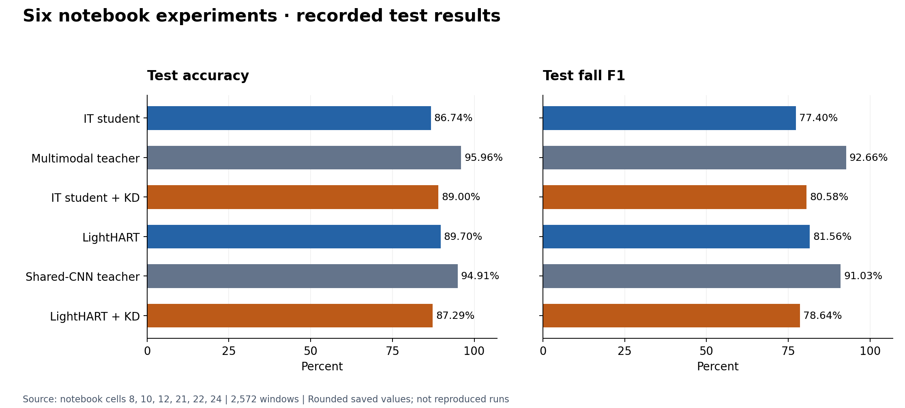
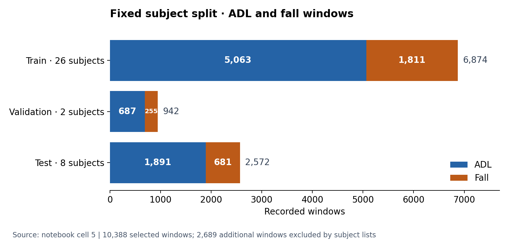
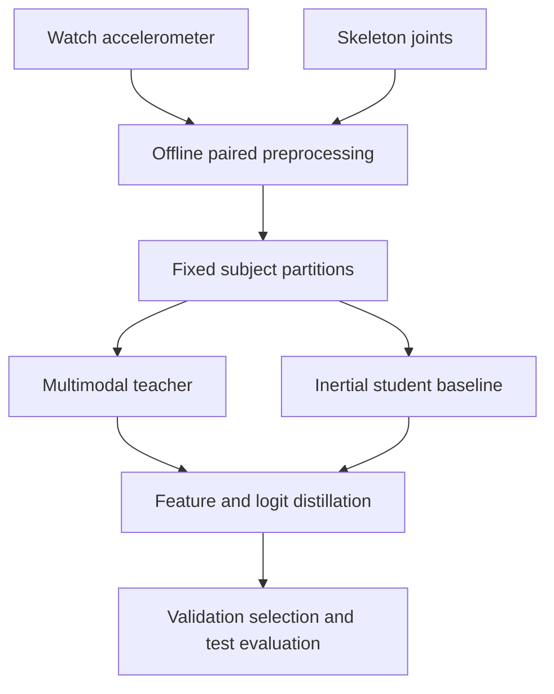

# SmartFallMM: Multimodal Fall Detection & Knowledge Distillation

**Watch accelerometer + skeleton teacher → accelerometer-only student models**

A PyTorch research project studying binary fall detection with inertial Transformers,
multimodal cross-attention, and two knowledge-distillation objectives. It preserves
six experiments from Pratyay Dhar's Kaggle notebook and makes their preprocessing,
training, evaluation, and inference accessible through a portable Python package.

> **Evidence status:** The comparison below is transcribed from saved notebook
> outputs. The dataset and trained checkpoints were not supplied, so these scores
> have **not** been reproduced. The refactor passes local CPU tests and synthetic
> training checks. This is an offline research pipeline; student windows currently
> depend on skeleton-assisted preprocessing.

[Recorded results](#recorded-results) · [Quick start](#quick-start) ·
[Scientific audit](docs/SCIENTIFIC_AUDIT.md) · [Reproduction guide](docs/REPRODUCING.md) ·
[Validation report](docs/VALIDATION.md)

## Technical focus

- Four preserved architectures: an inertial Transformer student, a multimodal
  teacher, LightHART, and a shared-CNN multimodal teacher.
- Two KD experiments: cosine feature alignment with symmetric-logit KL, and cosine
  feature alignment with temperature-scaled sigmoid MSE.
- Historical CSV processing: Butterworth filtering, centered acceleration
  magnitude, hip-centered skeletons, FastDTW alignment, and 64-frame windows.
- Explicit subject partitions, validation-only threshold tuning, early stopping,
  saved checkpoint metadata, and binary fall metrics.
- Source-linked results, an executed evidence walkthrough, model-forward parity
  checks, and synthetic training checks for every experiment configuration.

**Stack:** Python, PyTorch, NumPy, pandas, SciPy, FastDTW, scikit-learn,
Matplotlib, and Jupyter. TensorFlow/ONNX conversion appears only in the preserved
notebook's failed/unexecuted export attempt; deployment is not a verified feature.

## Recorded results

All rows use the notebook's recorded 2,572-window test partition: 1,891 ADL and
681 fall windows. Precision, recall, and F1 refer to **fall = 1**; F1 is not
Macro-F1. Values retain the notebook's four-decimal precision.

| Experiment | Inputs to model | Accuracy (%) | Fall precision (%) | Fall recall (%) | Fall F1 (%) | ROC-AUC | Threshold |
| --- | --- | ---: | ---: | ---: | ---: | ---: | ---: |
| IT student | Accelerometer | 86.74 | 70.53 | 85.76 | 77.40 | 0.9472 | 0.38 |
| Multimodal teacher | Accelerometer + skeleton | 95.96 | 89.25 | 96.33 | 92.66 | 0.9931 | 0.30 |
| IT student + KD | Accelerometer | 89.00 | 75.64 | 86.20 | 80.58 | 0.9559 | 0.44 |
| LightHART | Accelerometer | 89.70 | 77.51 | 86.05 | 81.56 | 0.9556 | 0.44 |
| Shared-CNN teacher | Accelerometer + skeleton | 94.91 | 85.26 | 97.65 | 91.03 | 0.9926 | 0.36 |
| LightHART + KD | Accelerometer | 87.29 | 70.82 | 88.40 | 78.64 | 0.9493 | 0.50 |



The first KD run has a higher recorded fall F1 than its IT baseline
(77.40% → 80.58%). The later LightHART KD run has a lower recorded fall F1 than
LightHART alone (81.56% → 78.64%). They are exploratory comparisons: losses,
training schedules, initialization, and checkpoint selection differ. In particular,
IT KD starts from a trained student; LightHART KD starts from a fresh student.
No repeated-seed uncertainty estimates are available.

Each number maps to a cell in [recorded_metrics.json](evidence/recorded_metrics.json).
[Original final summaries](evidence/final) and
[full validation histories](evidence/validation_history.json) are retained.
The notebook contains no genuine confusion-matrix or ROC-curve outputs, so none
are invented here. New runs save predictions and a confusion matrix.

## Dataset and protocol

The notebook references the
[SmartFallMM Kaggle mirror](https://www.kaggle.com/datasets/pratyaydhar/smartfallmmdataset).
The upstream source is the
[SmartFall Group at Texas State University](https://github.com/txst-cs-smartfall/SmartFallMM-Dataset).
This implementation uses watch accelerometer CSVs and 32-joint, 3-coordinate
skeleton CSVs. The source code maps activity IDs 1–9 to ADL and IDs 10–14 to fall.
No gyroscope or phone measurements are consumed by this implementation.

Notebook preprocessing output reports 13,077 windows across 53 observed subject
IDs, with tensors `(N, 64, 4)` and `(N, 64, 32, 3)`. The notebook's fixed subject
lists select only 10,388 of these windows:

| Partition | Subjects | Windows | ADL | Fall |
| --- | ---: | ---: | ---: | ---: |
| Train | 26 | 6,874 | 5,063 | 1,811 |
| Validation | 2 | 942 | 687 | 255 |
| Test | 8 | 2,572 | 1,891 | 681 |
| Excluded by configured subject lists | 17 | 2,689 | — | — |

The subject lists are disjoint. That checks partition membership, but does not
resolve the preprocessing caveats below. The held-out test subjects belong to the
notebook's young cohort; elderly-fall generalization is not established.



Obtain the data directly from its owners or the Kaggle mirror and retain its
provenance/version. The archive deliberately contains no raw sensor files,
processed arrays, or trained weights. See
[dataset access and attribution](docs/DATASET.md).

## Methodology



The diagram summarizes the first family. The second family uses a new LightHART
student for KD rather than initializing from its baseline checkpoint.

**Scientific boundaries:** Window selection uses the known activity label;
normalization and DTW use whole subject/activity groups; `filtfilt` is noncausal;
student windows use skeleton alignment. The notebook reads CSVs with `header=0`
and filters with an assumed 25 Hz rate, which disagree with the current upstream
format description. These choices are preserved for traceability and require a
separately evaluated redesign before raw accelerometer streaming claims are made.
See the [scientific audit](docs/SCIENTIFIC_AUDIT.md) for exact mechanisms.

## Quick start

Use Python 3.12 for the locally checked environment. Python 3.11+ is declared by the
package; other versions have not been tested here. Extract this archive and open
a terminal in its top-level folder. Once published, a checkout can be obtained with:

```bash
git clone https://github.com/pratyaydr/smartfall-multimodal-knowledge-distillation.git
cd smartfall-multimodal-knowledge-distillation
python -m venv .venv
```

Activate the environment on your platform:

```bash
# Linux / macOS
source .venv/bin/activate
```

```powershell
# Windows PowerShell
.venv\Scripts\Activate.ps1
```

Install a CPU environment and run the lightweight checks:

```bash
python -m pip install --upgrade pip
python -m pip install torch==2.15.0 --index-url https://download.pytorch.org/whl/cpu
python -m pip install -r requirements-tested.txt
python -m pytest -q
python scripts/check_evidence.py
python scripts/smoke_pipeline.py
```

The final command uses small synthetic data and temporary files. Passing it proves
that the pipeline runs; it does not reproduce a SmartFallMM benchmark.
For notebook editing, install `python -m pip install -e ".[notebook]"`.
FastDTW may require a C++ compiler if a wheel is unavailable.

### Preprocess and train

Arrange your downloaded dataset so the chosen root contains `young/` and `old/`
with `skeleton/` and `accelerometer/watch/` subfolders. CSV basenames must match,
for example `S29A10T01.csv`. Review the audit before using a different release.

```bash
smartfall preprocess --data-root data/raw/SmartFallMM-Dataset-main --output data/processed/smartfall.npz
smartfall train --config configs/it_student.json --data data/processed/smartfall.npz --output runs/it_student
smartfall train --config configs/teacher.json --data data/processed/smartfall.npz --output runs/teacher
smartfall train --config configs/it_kd.json --data data/processed/smartfall.npz --teacher-checkpoint runs/teacher/best.pt --student-checkpoint runs/it_student/best.pt --output runs/it_kd
```

Commands run from the repository root. Each output directory must be new.
Defaults follow the notebook's original epoch budgets and may require substantial
compute. Use `--device cpu` or `--device cuda` to choose explicitly.
For the LightHART family and archived checkpoint mapping, see
[the full reproduction guide](docs/REPRODUCING.md).

### Evaluate and predict

```bash
smartfall evaluate --checkpoint runs/it_kd/best.pt --data data/processed/smartfall.npz --output runs/it_kd/reevaluated.json
smartfall predict --checkpoint runs/it_kd/best.pt --accelerometer data/processed/inference_windows.npy --output runs/it_kd/predictions.json
```

`inference_windows.npy` is a user-supplied `(N,64,4)` array with the **same historical
preprocessing**, not raw sensor samples. Teachers additionally require `--skeleton`.
New checkpoints carry their validation-selected threshold; test evaluation never
retunes it. Bare notebook weights require an explicit config and threshold.

## Repository map

| Path | Purpose |
| --- | --- |
| [`notebooks/original_kaggle.ipynb`](notebooks/original_kaggle.ipynb) | Unchanged source, saved outputs, and original export failure |
| [`notebooks/evidence_walkthrough.ipynb`](notebooks/evidence_walkthrough.ipynb) | Executed, data-free review of evidence and model interfaces |
| [`CITATION.cff`](CITATION.cff) | Machine-readable software citation metadata |
| [`src/smartfall/`](src/smartfall) | Preprocessing, data validation, four models, KD losses, training, evaluation, CLI |
| [`configs/`](configs) | Six experiments and the original static subject split |
| [`evidence/`](evidence) | Extracted outputs, source hash, validation histories, synthetic check status |
| [`assets/figures/`](assets/figures) | Charts derived from actual saved output values |
| [`scripts/`](scripts) | Evidence validation, chart generation, synthetic end-to-end checks |
| [`tests/`](tests) | Source parity, preprocessing, splits, metrics, losses, and error checks |
| [`docs/`](docs) | Scientific audit, dataset notes, reproduction, validation, publication guide |
| [`.github/workflows/ci.yml`](.github/workflows/ci.yml) | Configured CPU checks; hosted CI has not yet run |

## Limitations and next experiments

- Obtain and fingerprint the exact source dataset and checkpoint artifacts, then
  reproduce predictions before claiming score reproduction.
- Redesign segmentation without access to activity labels and make the student
  preprocessing independent of skeleton data.
- Audit CSV headers, time stamps, sampling rates, row trimming, and trial
  boundaries. Evaluate each corrected protocol as a new experiment.
- Add repeated subject folds/seeds and subject-level uncertainty; windows overlap
  and are not independent observations.
- Compare KD with matched initialization, augmentation, loss, and checkpoint
  criteria. Keep the negative LightHART KD result visible.
- Measure false alarms over continuous recordings and deployment latency on target
  hardware. TFLite/ONNX export is not implemented as a validated package feature.

These are proposed improvements, not completed experiments.

## Attribution and licensing

**Author:** Pratyay Dhar

- **Original Kaggle notebook:** [SmartFallMM notebook](https://www.kaggle.com/code/pratyaydhar/notebook2d06429765)

The dataset belongs to the SmartFall Group, Texas State University. No open-source
license has been selected for this repository, and no dataset redistribution
permission is implied. See [THIRD_PARTY_NOTICES.md](THIRD_PARTY_NOTICES.md).
